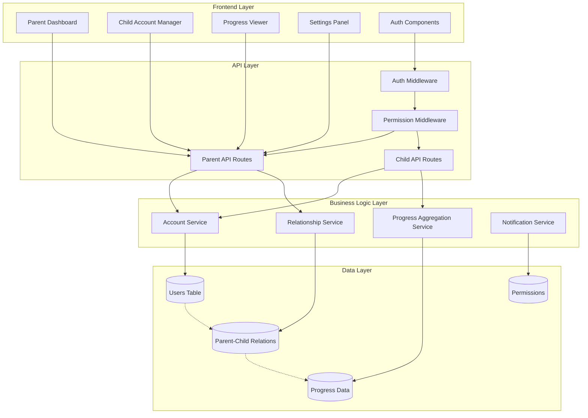
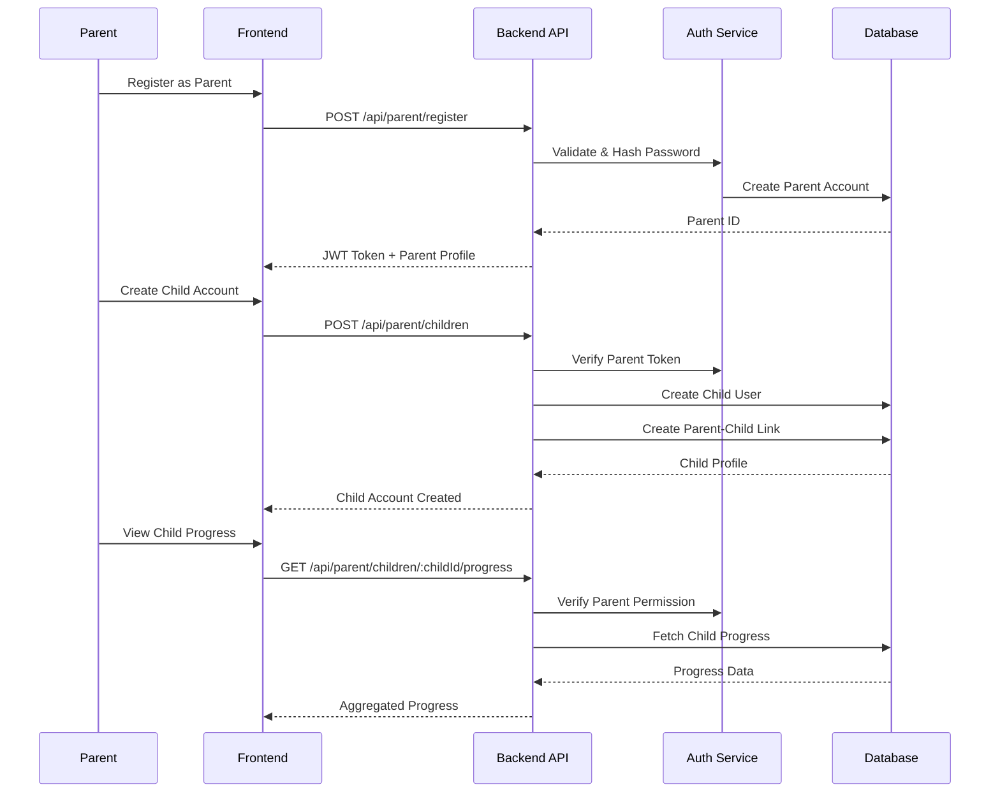

# Design Document: Parent Account System

## Overview

The Parent Account System enables parents to create accounts, manage multiple child accounts, monitor their children's learning progress, and control access permissions. This system addresses COPPA compliance requirements for users under 13 and provides parents with comprehensive oversight of their children's coding education journey.

The system introduces a hierarchical account structure where parent accounts can create and manage multiple child accounts, view aggregated progress data, set learning goals, and receive notifications about achievements and milestones. The design maintains backward compatibility with existing single-user accounts while adding robust parent-child relationship management.

## Architecture



## Main Workflow




## Components and Interfaces

### Component 1: ParentAccountService

**Purpose**: Manages parent account creation, authentication, and profile management

**Interface**:
```typescript
interface ParentAccountService {
  registerParent(data: ParentRegistrationData): Promise<ParentAccount>
  authenticateParent(email: string, password: string): Promise<AuthResult>
  updateParentProfile(parentId: number, updates: Partial<ParentProfile>): Promise<ParentAccount>
  deleteParentAccount(parentId: number): Promise<void>
  getParentProfile(parentId: number): Promise<ParentAccount>
}

interface ParentRegistrationData {
  email: string
  password: string
  firstName: string
  lastName: string
  phoneNumber?: string
  notificationPreferences?: NotificationPreferences
}

interface ParentAccount {
  id: number
  email: string
  firstName: string
  lastName: string
  phoneNumber?: string
  accountType: 'parent'
  createdAt: Date
  lastActive: Date
  notificationPreferences: NotificationPreferences
}

interface NotificationPreferences {
  emailNotifications: boolean
  weeklyReports: boolean
  achievementAlerts: boolean
  loginAlerts: boolean
}
```

**Responsibilities**:
- Validate parent registration data (email format, password strength)
- Hash passwords using bcrypt with salt rounds >= 10
- Generate JWT tokens with parent-specific claims
- Enforce unique email constraints
- Handle password reset flows

### Component 2: ChildAccountService

**Purpose**: Manages child account creation, updates, and deletion under parent supervision

**Interface**:
```typescript
interface ChildAccountService {
  createChildAccount(parentId: number, data: ChildAccountData): Promise<ChildAccount>
  updateChildAccount(childId: number, updates: Partial<ChildAccountData>): Promise<ChildAccount>
  deleteChildAccount(childId: number, parentId: number): Promise<void>
  getChildAccount(childId: number): Promise<ChildAccount>
  listChildrenByParent(parentId: number): Promise<ChildAccount[]>
  switchChildAccount(parentId: number, childId: number): Promise<AuthResult>
}

interface ChildAccountData {
  username: string
  displayName: string
  age: number
  avatarUrl?: string
  learningGoals?: string[]
  restrictions?: AccountRestrictions
}

interface ChildAccount {
  id: number
  parentId: number
  username: string
  displayName: string
  age: number
  avatarUrl?: string
  accountType: 'child'
  xp: number
  streak: number
  level: number
  createdAt: Date
  lastActive: Date
  restrictions: AccountRestrictions
}

interface AccountRestrictions {
  maxDailyMinutes?: number
  allowedDays?: string[]  // ['monday', 'tuesday', ...]
  contentFilters?: string[]
  requireParentApproval?: boolean
}
```

**Responsibilities**:
- Create child accounts linked to parent
- Validate age requirements (must be under 18)
- Generate child-specific usernames (no email required)
- Enforce parental restrictions
- Handle account switching for parents

### Component 3: ParentChildRelationshipService

**Purpose**: Manages the relationships between parent and child accounts

**Interface**:
```typescript
interface ParentChildRelationshipService {
  linkChildToParent(parentId: number, childId: number): Promise<Relationship>
  unlinkChildFromParent(parentId: number, childId: number): Promise<void>
  verifyParentChildRelationship(parentId: number, childId: number): Promise<boolean>
  transferChildOwnership(childId: number, fromParentId: number, toParentId: number): Promise<void>
  getParentByChild(childId: number): Promise<ParentAccount>
  getChildrenByParent(parentId: number): Promise<ChildAccount[]>
}

interface Relationship {
  id: number
  parentId: number
  childId: number
  relationshipType: 'primary' | 'secondary'
  permissions: ParentPermissions
  createdAt: Date
}

interface ParentPermissions {
  canViewProgress: boolean
  canModifySettings: boolean
  canDeleteAccount: boolean
  canManageRestrictions: boolean
}
```

**Responsibilities**:
- Maintain parent-child relationship integrity
- Support multiple parents per child (divorced/separated families)
- Enforce permission levels
- Validate relationship operations
- Handle ownership transfers

### Component 4: ProgressAggregationService

**Purpose**: Aggregates and analyzes child progress data for parent viewing

**Interface**:
```typescript
interface ProgressAggregationService {
  getChildProgress(childId: number): Promise<ProgressSummary>
  getMultiChildProgress(parentId: number): Promise<MultiChildProgress>
  getWeeklyActivity(childId: number, weeks: number): Promise<ActivityData[]>
  getModulePerformance(childId: number, moduleId: number): Promise<ModulePerformance>
  generateProgressReport(childId: number, startDate: Date, endDate: Date): Promise<ProgressReport>
}

interface ProgressSummary {
  childId: number
  totalXP: number
  currentLevel: number
  streak: number
  completedLessons: number
  totalLessons: number
  averageScore: number
  timeSpentMinutes: number
  lastActive: Date
  recentAchievements: Achievement[]
}

interface MultiChildProgress {
  parentId: number
  children: ProgressSummary[]
  totalFamilyXP: number
  mostActiveChild: number
  familyStreak: number
}

interface ActivityData {
  date: Date
  lessonsCompleted: number
  timeSpentMinutes: number
  xpEarned: number
  active: boolean
}

interface ModulePerformance {
  moduleId: number
  moduleName: string
  completedLessons: number
  totalLessons: number
  averageScore: number
  timeSpent: number
  strengths: string[]
  weaknesses: string[]
}

interface ProgressReport {
  childId: number
  period: { start: Date; end: Date }
  summary: ProgressSummary
  moduleBreakdown: ModulePerformance[]
  activityChart: ActivityData[]
  recommendations: string[]
  exportUrl?: string
}
```

**Responsibilities**:
- Aggregate progress data from multiple sources
- Calculate performance metrics and statistics
- Identify learning patterns and trends
- Generate exportable reports (PDF/CSV)
- Cache frequently accessed data


### Component 5: AuthenticationMiddleware

**Purpose**: Validates JWT tokens and enforces parent/child access control

**Interface**:
```typescript
interface AuthenticationMiddleware {
  authenticateToken(req: Request, res: Response, next: NextFunction): void
  requireParentAccount(req: Request, res: Response, next: NextFunction): void
  requireChildAccount(req: Request, res: Response, next: NextFunction): void
  verifyParentChildAccess(req: Request, res: Response, next: NextFunction): void
}

interface AuthenticatedRequest extends Request {
  user: {
    id: number
    email?: string
    username?: string
    accountType: 'parent' | 'child'
    parentId?: number  // Only for child accounts
  }
}
```

**Responsibilities**:
- Verify JWT token validity and expiration
- Extract user information from token
- Enforce account type restrictions
- Validate parent-child relationship for protected routes
- Handle token refresh logic

### Component 6: NotificationService

**Purpose**: Sends notifications to parents about child activities and achievements

**Interface**:
```typescript
interface NotificationService {
  sendAchievementNotification(parentId: number, childId: number, achievement: Achievement): Promise<void>
  sendWeeklyReport(parentId: number): Promise<void>
  sendLoginAlert(parentId: number, childId: number, loginTime: Date): Promise<void>
  sendGoalCompletionNotification(parentId: number, childId: number, goal: Goal): Promise<void>
  queueNotification(notification: Notification): Promise<void>
  getNotificationHistory(parentId: number, limit: number): Promise<Notification[]>
}

interface Notification {
  id: number
  parentId: number
  childId?: number
  type: 'achievement' | 'weekly_report' | 'login_alert' | 'goal_completion'
  title: string
  message: string
  data?: any
  read: boolean
  createdAt: Date
}

interface Goal {
  id: number
  childId: number
  title: string
  description: string
  targetValue: number
  currentValue: number
  completed: boolean
  deadline?: Date
}
```

**Responsibilities**:
- Queue and send email notifications
- Generate weekly progress reports
- Track notification delivery status
- Respect parent notification preferences
- Batch notifications to avoid spam

## Data Models

### Model 1: Users Table (Extended)

```typescript
interface User {
  id: number
  accountType: 'parent' | 'child'
  
  // Parent-specific fields
  email?: string  // Required for parents, null for children
  password?: string  // Required for parents, null for children
  firstName?: string
  lastName?: string
  phoneNumber?: string
  
  // Child-specific fields
  username?: string  // Required for children
  displayName?: string
  age?: number
  parentId?: number  // Foreign key to parent user
  
  // Common fields
  avatarUrl?: string
  xp: number
  streak: number
  lastActive: Date
  createdAt: Date
  updatedAt: Date
}
```

**Validation Rules**:
- `accountType` must be either 'parent' or 'child'
- Parent accounts: `email` and `password` are required
- Child accounts: `username`, `age`, and `parentId` are required
- Email must be unique across all parent accounts
- Username must be unique across all child accounts
- Age must be between 4 and 17 for child accounts
- Password must be at least 8 characters with mixed case and numbers

### Model 2: ParentChildRelationships Table

```typescript
interface ParentChildRelationship {
  id: number
  parentId: number  // Foreign key to users.id where accountType='parent'
  childId: number   // Foreign key to users.id where accountType='child'
  relationshipType: 'primary' | 'secondary'
  permissions: {
    canViewProgress: boolean
    canModifySettings: boolean
    canDeleteAccount: boolean
    canManageRestrictions: boolean
  }
  createdAt: Date
  updatedAt: Date
}
```

**Validation Rules**:
- `parentId` must reference a user with `accountType='parent'`
- `childId` must reference a user with `accountType='child'`
- Unique constraint on (parentId, childId) pair
- At least one 'primary' relationship must exist per child
- Cannot create circular relationships

### Model 3: AccountRestrictions Table

```typescript
interface AccountRestriction {
  id: number
  childId: number  // Foreign key to users.id
  maxDailyMinutes?: number
  allowedDays?: string  // JSON array: ['monday', 'tuesday', ...]
  contentFilters?: string  // JSON array of filter types
  requireParentApproval: boolean
  activeFrom?: Date
  activeUntil?: Date
  createdBy: number  // Parent user ID
  createdAt: Date
  updatedAt: Date
}
```

**Validation Rules**:
- `childId` must reference a child account
- `maxDailyMinutes` must be between 0 and 1440 (24 hours)
- `allowedDays` must contain valid day names
- `createdBy` must reference a parent with permission to manage restrictions

### Model 4: NotificationPreferences Table

```typescript
interface NotificationPreference {
  id: number
  parentId: number  // Foreign key to users.id
  emailNotifications: boolean
  weeklyReports: boolean
  achievementAlerts: boolean
  loginAlerts: boolean
  reportDay: string  // Day of week for weekly reports
  reportTime: string  // Time of day (HH:MM format)
  createdAt: Date
  updatedAt: Date
}
```

**Validation Rules**:
- `parentId` must reference a parent account
- `reportDay` must be a valid day name
- `reportTime` must be in HH:MM format (24-hour)
- One record per parent (unique constraint on parentId)

### Model 5: SessionLog Table

```typescript
interface SessionLog {
  id: number
  userId: number  // Child user ID
  loginTime: Date
  logoutTime?: Date
  durationMinutes?: number
  ipAddress?: string
  userAgent?: string
  parentNotified: boolean
  createdAt: Date
}
```

**Validation Rules**:
- `userId` must reference a child account
- `loginTime` must be before `logoutTime`
- `durationMinutes` calculated as difference between login and logout
- `parentNotified` defaults to false


## Algorithmic Pseudocode

### Main Processing Algorithm: Parent Registration

```pascal
ALGORITHM registerParent(registrationData)
INPUT: registrationData of type ParentRegistrationData
OUTPUT: result of type { success: boolean, parent?: ParentAccount, error?: string }

PRECONDITIONS:
  - registrationData.email is non-empty and valid email format
  - registrationData.password is non-empty and meets strength requirements
  - registrationData.firstName and lastName are non-empty strings

POSTCONDITIONS:
  - If successful: parent account created in database with hashed password
  - If successful: JWT token generated and returned
  - If failed: no database changes, error message returned
  - Email uniqueness enforced

BEGIN
  // Step 1: Validate input data
  validationResult ← validateParentRegistration(registrationData)
  IF validationResult.isValid = false THEN
    RETURN { success: false, error: validationResult.error }
  END IF
  
  // Step 2: Check email uniqueness
  existingUser ← database.findUserByEmail(registrationData.email)
  IF existingUser ≠ null THEN
    RETURN { success: false, error: "Email already registered" }
  END IF
  
  // Step 3: Hash password securely
  passwordHash ← bcrypt.hash(registrationData.password, SALT_ROUNDS)
  ASSERT passwordHash ≠ null AND length(passwordHash) > 0
  
  // Step 4: Create parent account
  parentAccount ← {
    accountType: 'parent',
    email: registrationData.email,
    password: passwordHash,
    firstName: registrationData.firstName,
    lastName: registrationData.lastName,
    phoneNumber: registrationData.phoneNumber,
    xp: 0,
    streak: 0,
    createdAt: currentTimestamp(),
    lastActive: currentTimestamp()
  }
  
  // Step 5: Insert into database
  TRY
    savedParent ← database.insertUser(parentAccount)
    ASSERT savedParent.id > 0
  CATCH error
    RETURN { success: false, error: "Database error: " + error.message }
  END TRY
  
  // Step 6: Create default notification preferences
  notificationPrefs ← {
    parentId: savedParent.id,
    emailNotifications: true,
    weeklyReports: true,
    achievementAlerts: true,
    loginAlerts: false,
    reportDay: 'sunday',
    reportTime: '18:00'
  }
  database.insertNotificationPreferences(notificationPrefs)
  
  // Step 7: Generate JWT token
  token ← jwt.sign({
    id: savedParent.id,
    email: savedParent.email,
    accountType: 'parent'
  }, JWT_SECRET, { expiresIn: '7d' })
  
  ASSERT token ≠ null AND length(token) > 0
  
  // Step 8: Return success result
  RETURN {
    success: true,
    parent: savedParent,
    token: token
  }
END

LOOP INVARIANTS: N/A (no loops in main algorithm)
```

### Algorithm: Create Child Account

```pascal
ALGORITHM createChildAccount(parentId, childData)
INPUT: parentId of type integer, childData of type ChildAccountData
OUTPUT: result of type { success: boolean, child?: ChildAccount, error?: string }

PRECONDITIONS:
  - parentId references valid parent account in database
  - childData.username is non-empty and alphanumeric
  - childData.age is between 4 and 17
  - childData.displayName is non-empty string

POSTCONDITIONS:
  - If successful: child account created and linked to parent
  - If successful: parent-child relationship record created
  - If failed: no database changes, error message returned
  - Username uniqueness enforced across all child accounts

BEGIN
  // Step 1: Verify parent exists and has permission
  parent ← database.findUserById(parentId)
  IF parent = null OR parent.accountType ≠ 'parent' THEN
    RETURN { success: false, error: "Invalid parent account" }
  END IF
  
  // Step 2: Validate child data
  validationResult ← validateChildData(childData)
  IF validationResult.isValid = false THEN
    RETURN { success: false, error: validationResult.error }
  END IF
  
  // Step 3: Check username uniqueness
  existingChild ← database.findChildByUsername(childData.username)
  IF existingChild ≠ null THEN
    RETURN { success: false, error: "Username already taken" }
  END IF
  
  // Step 4: Check parent's child limit (max 10 children)
  childCount ← database.countChildrenByParent(parentId)
  IF childCount >= MAX_CHILDREN_PER_PARENT THEN
    RETURN { success: false, error: "Maximum children limit reached" }
  END IF
  
  // Step 5: Create child account
  childAccount ← {
    accountType: 'child',
    username: childData.username,
    displayName: childData.displayName,
    age: childData.age,
    avatarUrl: childData.avatarUrl OR generateDefaultAvatar(),
    parentId: parentId,
    xp: 0,
    streak: 0,
    createdAt: currentTimestamp(),
    lastActive: currentTimestamp()
  }
  
  // Step 6: Insert child into database (transaction start)
  BEGIN TRANSACTION
    TRY
      savedChild ← database.insertUser(childAccount)
      ASSERT savedChild.id > 0
      
      // Step 7: Create parent-child relationship
      relationship ← {
        parentId: parentId,
        childId: savedChild.id,
        relationshipType: 'primary',
        permissions: {
          canViewProgress: true,
          canModifySettings: true,
          canDeleteAccount: true,
          canManageRestrictions: true
        },
        createdAt: currentTimestamp()
      }
      database.insertRelationship(relationship)
      
      // Step 8: Create default restrictions if specified
      IF childData.restrictions ≠ null THEN
        restrictions ← {
          childId: savedChild.id,
          maxDailyMinutes: childData.restrictions.maxDailyMinutes,
          allowedDays: childData.restrictions.allowedDays,
          contentFilters: childData.restrictions.contentFilters,
          requireParentApproval: childData.restrictions.requireParentApproval,
          createdBy: parentId,
          createdAt: currentTimestamp()
        }
        database.insertRestrictions(restrictions)
      END IF
      
      COMMIT TRANSACTION
      
      RETURN {
        success: true,
        child: savedChild
      }
      
    CATCH error
      ROLLBACK TRANSACTION
      RETURN { success: false, error: "Failed to create child account: " + error.message }
    END TRY
  END TRANSACTION
END

LOOP INVARIANTS: N/A (no loops in main algorithm)
```

### Algorithm: Verify Parent-Child Access

```pascal
ALGORITHM verifyParentChildAccess(parentId, childId, requiredPermission)
INPUT: parentId of type integer, childId of type integer, requiredPermission of type string
OUTPUT: hasAccess of type boolean

PRECONDITIONS:
  - parentId references valid parent account
  - childId references valid child account
  - requiredPermission is one of: 'viewProgress', 'modifySettings', 'deleteAccount', 'manageRestrictions'

POSTCONDITIONS:
  - Returns true if and only if parent has required permission for child
  - Returns false if relationship doesn't exist or permission denied
  - No database modifications

BEGIN
  // Step 1: Fetch relationship
  relationship ← database.findRelationship(parentId, childId)
  
  IF relationship = null THEN
    RETURN false
  END IF
  
  // Step 2: Check specific permission
  CASE requiredPermission OF
    'viewProgress':
      RETURN relationship.permissions.canViewProgress
    'modifySettings':
      RETURN relationship.permissions.canModifySettings
    'deleteAccount':
      RETURN relationship.permissions.canDeleteAccount
    'manageRestrictions':
      RETURN relationship.permissions.canManageRestrictions
    DEFAULT:
      RETURN false
  END CASE
END

LOOP INVARIANTS: N/A (no loops)
```

### Algorithm: Aggregate Child Progress

```pascal
ALGORITHM aggregateChildProgress(childId)
INPUT: childId of type integer
OUTPUT: progressSummary of type ProgressSummary

PRECONDITIONS:
  - childId references valid child account in database
  - Progress data exists for the child (may be empty)

POSTCONDITIONS:
  - Returns complete progress summary with calculated metrics
  - All numeric fields are non-negative
  - Percentages are between 0 and 100
  - No database modifications

BEGIN
  // Step 1: Fetch child account
  child ← database.findUserById(childId)
  ASSERT child ≠ null AND child.accountType = 'child'
  
  // Step 2: Fetch all progress records
  progressRecords ← database.findProgressByUserId(childId)
  
  // Step 3: Calculate completed lessons
  completedLessons ← 0
  totalScore ← 0
  
  FOR EACH record IN progressRecords DO
    ASSERT record.userId = childId
    
    IF record.completed = true THEN
      completedLessons ← completedLessons + 1
      totalScore ← totalScore + record.score
    END IF
  END FOR
  
  ASSERT completedLessons >= 0
  
  // Step 4: Calculate average score
  IF completedLessons > 0 THEN
    averageScore ← totalScore / completedLessons
  ELSE
    averageScore ← 0
  END IF
  
  ASSERT averageScore >= 0 AND averageScore <= 100
  
  // Step 5: Get total lessons count
  totalLessons ← database.countAllLessons()
  ASSERT totalLessons > 0
  
  // Step 6: Calculate time spent
  sessionLogs ← database.findSessionLogsByUserId(childId)
  totalMinutes ← 0
  
  FOR EACH session IN sessionLogs DO
    IF session.durationMinutes ≠ null THEN
      totalMinutes ← totalMinutes + session.durationMinutes
    END IF
  END FOR
  
  ASSERT totalMinutes >= 0
  
  // Step 7: Fetch recent achievements
  recentAchievements ← database.findRecentAchievements(childId, LIMIT: 5)
  
  // Step 8: Calculate current level
  currentLevel ← floor(child.xp / XP_PER_LEVEL) + 1
  ASSERT currentLevel >= 1
  
  // Step 9: Build summary object
  progressSummary ← {
    childId: childId,
    totalXP: child.xp,
    currentLevel: currentLevel,
    streak: child.streak,
    completedLessons: completedLessons,
    totalLessons: totalLessons,
    averageScore: round(averageScore, 2),
    timeSpentMinutes: totalMinutes,
    lastActive: child.lastActive,
    recentAchievements: recentAchievements
  }
  
  RETURN progressSummary
END

LOOP INVARIANTS:
  - For progress records loop: All processed records have valid scores (0-100)
  - For session logs loop: totalMinutes accumulates only non-negative durations
  - completedLessons count never decreases during iteration
```


## Key Functions with Formal Specifications

### Function 1: validateParentRegistration()

```typescript
function validateParentRegistration(data: ParentRegistrationData): ValidationResult
```

**Preconditions:**
- `data` is non-null object
- `data.email` is defined (may be invalid format)
- `data.password` is defined (may be weak)
- `data.firstName` and `data.lastName` are defined

**Postconditions:**
- Returns `ValidationResult` with `isValid: true` if all validations pass
- Returns `ValidationResult` with `isValid: false` and descriptive error if any validation fails
- No side effects on input data
- No database queries or modifications

**Loop Invariants:** N/A (no loops)

### Function 2: hashPassword()

```typescript
function hashPassword(plainPassword: string, saltRounds: number): Promise<string>
```

**Preconditions:**
- `plainPassword` is non-empty string
- `saltRounds` is integer >= 10
- bcrypt library is available and initialized

**Postconditions:**
- Returns hashed password string of length >= 60 characters
- Hash is deterministically verifiable with bcrypt.compare()
- Original password cannot be recovered from hash
- Same password with different salts produces different hashes
- Function is async and returns Promise

**Loop Invariants:** N/A (bcrypt internal implementation)

### Function 3: generateJWT()

```typescript
function generateJWT(payload: JWTPayload, secret: string, options: JWTOptions): string
```

**Preconditions:**
- `payload` contains required fields: id, accountType
- `secret` is non-empty string (minimum 32 characters recommended)
- `options.expiresIn` is valid time string (e.g., '7d', '24h')
- jsonwebtoken library is available

**Postconditions:**
- Returns valid JWT token string in format: header.payload.signature
- Token can be verified using same secret
- Token expires after specified duration
- Payload is encoded but not encrypted (readable if decoded)
- Token length is proportional to payload size

**Loop Invariants:** N/A (jwt library internal)

### Function 4: verifyJWT()

```typescript
function verifyJWT(token: string, secret: string): JWTPayload | null
```

**Preconditions:**
- `token` is non-empty string
- `secret` matches the secret used to generate token
- jsonwebtoken library is available

**Postconditions:**
- Returns decoded payload if token is valid and not expired
- Returns null if token is invalid, expired, or signature doesn't match
- No side effects
- Does not modify token or secret

**Loop Invariants:** N/A

### Function 5: checkDailyTimeLimit()

```typescript
function checkDailyTimeLimit(childId: number, restrictions: AccountRestriction): Promise<TimeCheckResult>
```

**Preconditions:**
- `childId` references valid child account
- `restrictions` object contains `maxDailyMinutes` field
- Current date/time is available
- Session logs table is accessible

**Postconditions:**
- Returns `TimeCheckResult` with `allowed: true` if under daily limit
- Returns `TimeCheckResult` with `allowed: false` and remaining time if limit exceeded
- Calculates time spent today (00:00 to current time)
- Does not modify any database records

**Loop Invariants:**
- For session iteration: accumulated time never decreases
- All session durations are non-negative

### Function 6: enforceContentFilters()

```typescript
function enforceContentFilters(childId: number, contentId: number): Promise<boolean>
```

**Preconditions:**
- `childId` references valid child account
- `contentId` references valid lesson/module
- Account restrictions exist for child
- Content metadata is available

**Postconditions:**
- Returns true if content is allowed based on filters
- Returns false if content is blocked by any active filter
- Checks age-appropriateness, difficulty level, and custom filters
- No database modifications

**Loop Invariants:**
- For filter iteration: if any filter blocks content, result is false
- All filters are evaluated (no short-circuit unless explicitly blocked)

## Example Usage

### Example 1: Parent Registration Flow

```typescript
// Frontend: Parent registration form submission
const registrationData: ParentRegistrationData = {
  email: "parent@example.com",
  password: "SecurePass123!",
  firstName: "Jane",
  lastName: "Doe",
  phoneNumber: "+1234567890",
  notificationPreferences: {
    emailNotifications: true,
    weeklyReports: true,
    achievementAlerts: true,
    loginAlerts: false
  }
}

// API call
const response = await fetch('/api/parent/register', {
  method: 'POST',
  headers: { 'Content-Type': 'application/json' },
  body: JSON.stringify(registrationData)
})

const result = await response.json()

if (result.success) {
  // Store JWT token
  localStorage.setItem('auth_token', result.token)
  
  // Store parent profile
  localStorage.setItem('user_profile', JSON.stringify(result.parent))
  
  // Redirect to parent dashboard
  navigate('/parent/dashboard')
} else {
  // Display error message
  showError(result.error)
}
```

### Example 2: Creating Child Account

```typescript
// Frontend: Child account creation form
const childData: ChildAccountData = {
  username: "johnny_coder",
  displayName: "Johnny",
  age: 10,
  avatarUrl: "/avatars/robot-blue.png",
  learningGoals: ["Learn JavaScript", "Build a game"],
  restrictions: {
    maxDailyMinutes: 60,
    allowedDays: ['monday', 'tuesday', 'wednesday', 'thursday', 'friday'],
    contentFilters: ['age-appropriate'],
    requireParentApproval: false
  }
}

// API call with parent authentication
const response = await fetch('/api/parent/children', {
  method: 'POST',
  headers: {
    'Content-Type': 'application/json',
    'Authorization': `Bearer ${parentToken}`
  },
  body: JSON.stringify(childData)
})

const result = await response.json()

if (result.success) {
  console.log('Child account created:', result.child)
  // Refresh children list
  loadChildren()
} else {
  showError(result.error)
}
```

### Example 3: Viewing Child Progress

```typescript
// Frontend: Parent viewing specific child's progress
const childId = 42

// Fetch progress summary
const progressResponse = await fetch(`/api/parent/children/${childId}/progress`, {
  headers: {
    'Authorization': `Bearer ${parentToken}`
  }
})

const progress: ProgressSummary = await progressResponse.json()

// Display progress metrics
console.log(`${progress.childId} Progress:`)
console.log(`Level: ${progress.currentLevel}`)
console.log(`XP: ${progress.totalXP}`)
console.log(`Completed: ${progress.completedLessons}/${progress.totalLessons} lessons`)
console.log(`Average Score: ${progress.averageScore}%`)
console.log(`Streak: ${progress.streak} days`)
console.log(`Time Spent: ${progress.timeSpentMinutes} minutes`)

// Fetch weekly activity
const activityResponse = await fetch(`/api/parent/children/${childId}/activity?weeks=4`, {
  headers: {
    'Authorization': `Bearer ${parentToken}`
  }
})

const activity: ActivityData[] = await activityResponse.json()

// Render activity chart
renderActivityChart(activity)
```

### Example 4: Switching to Child Account

```typescript
// Parent wants to log in as child to help them
const childId = 42

const response = await fetch('/api/parent/switch-child', {
  method: 'POST',
  headers: {
    'Content-Type': 'application/json',
    'Authorization': `Bearer ${parentToken}`
  },
  body: JSON.stringify({ childId })
})

const result = await response.json()

if (result.success) {
  // Store child session token
  localStorage.setItem('child_session_token', result.token)
  localStorage.setItem('child_profile', JSON.stringify(result.child))
  
  // Store parent token for switching back
  localStorage.setItem('parent_return_token', parentToken)
  
  // Redirect to child dashboard
  navigate('/dashboard')
} else {
  showError(result.error)
}
```

### Example 5: Enforcing Time Restrictions

```typescript
// Backend middleware: Check if child can access platform
async function checkTimeRestrictions(req: AuthenticatedRequest, res: Response, next: NextFunction) {
  if (req.user.accountType !== 'child') {
    return next() // No restrictions for parents
  }
  
  const childId = req.user.id
  
  // Fetch restrictions
  const restrictions = await db.findRestrictionsByChildId(childId)
  
  if (!restrictions) {
    return next() // No restrictions set
  }
  
  // Check allowed days
  const today = new Date().toLocaleDateString('en-US', { weekday: 'lowercase' })
  if (restrictions.allowedDays && !restrictions.allowedDays.includes(today)) {
    return res.status(403).json({
      error: 'Access not allowed today',
      message: 'Your parent has set specific days for coding practice'
    })
  }
  
  // Check daily time limit
  if (restrictions.maxDailyMinutes) {
    const timeCheck = await checkDailyTimeLimit(childId, restrictions)
    
    if (!timeCheck.allowed) {
      return res.status(403).json({
        error: 'Daily time limit reached',
        message: `You've used your ${restrictions.maxDailyMinutes} minutes for today`,
        remainingMinutes: 0,
        resetTime: timeCheck.resetTime
      })
    }
  }
  
  // All checks passed
  next()
}
```


## API Endpoints

### Parent Account Endpoints

#### POST /api/parent/register
**Purpose**: Register a new parent account

**Request Body**:
```typescript
{
  email: string
  password: string
  firstName: string
  lastName: string
  phoneNumber?: string
}
```

**Response** (200 OK):
```typescript
{
  success: true
  token: string
  parent: ParentAccount
}
```

**Error Responses**:
- 400: Invalid input data
- 409: Email already registered
- 500: Server error

#### POST /api/parent/login
**Purpose**: Authenticate parent account

**Request Body**:
```typescript
{
  email: string
  password: string
}
```

**Response** (200 OK):
```typescript
{
  success: true
  token: string
  parent: ParentAccount
  children: ChildAccount[]
}
```

**Error Responses**:
- 401: Invalid credentials
- 500: Server error

#### GET /api/parent/profile
**Purpose**: Get parent profile information

**Headers**: `Authorization: Bearer <token>`

**Response** (200 OK):
```typescript
{
  parent: ParentAccount
  childrenCount: number
}
```

**Error Responses**:
- 401: Unauthorized
- 404: Parent not found

#### PUT /api/parent/profile
**Purpose**: Update parent profile

**Headers**: `Authorization: Bearer <token>`

**Request Body**:
```typescript
{
  firstName?: string
  lastName?: string
  phoneNumber?: string
  notificationPreferences?: NotificationPreferences
}
```

**Response** (200 OK):
```typescript
{
  success: true
  parent: ParentAccount
}
```

### Child Account Endpoints

#### POST /api/parent/children
**Purpose**: Create a new child account

**Headers**: `Authorization: Bearer <parent_token>`

**Request Body**:
```typescript
{
  username: string
  displayName: string
  age: number
  avatarUrl?: string
  learningGoals?: string[]
  restrictions?: AccountRestrictions
}
```

**Response** (201 Created):
```typescript
{
  success: true
  child: ChildAccount
}
```

**Error Responses**:
- 400: Invalid input data
- 401: Unauthorized (not a parent)
- 409: Username already taken
- 429: Maximum children limit reached

#### GET /api/parent/children
**Purpose**: List all children for authenticated parent

**Headers**: `Authorization: Bearer <parent_token>`

**Response** (200 OK):
```typescript
{
  children: ChildAccount[]
  total: number
}
```

#### GET /api/parent/children/:childId
**Purpose**: Get specific child account details

**Headers**: `Authorization: Bearer <parent_token>`

**Response** (200 OK):
```typescript
{
  child: ChildAccount
  restrictions: AccountRestriction
}
```

**Error Responses**:
- 401: Unauthorized
- 403: Not your child
- 404: Child not found

#### PUT /api/parent/children/:childId
**Purpose**: Update child account settings

**Headers**: `Authorization: Bearer <parent_token>`

**Request Body**:
```typescript
{
  displayName?: string
  avatarUrl?: string
  learningGoals?: string[]
}
```

**Response** (200 OK):
```typescript
{
  success: true
  child: ChildAccount
}
```

#### DELETE /api/parent/children/:childId
**Purpose**: Delete child account (requires confirmation)

**Headers**: `Authorization: Bearer <parent_token>`

**Request Body**:
```typescript
{
  confirmPassword: string
}
```

**Response** (200 OK):
```typescript
{
  success: true
  message: "Child account deleted"
}
```

**Error Responses**:
- 401: Unauthorized
- 403: Incorrect password or insufficient permissions
- 404: Child not found

#### POST /api/parent/switch-child
**Purpose**: Generate session token to access child account

**Headers**: `Authorization: Bearer <parent_token>`

**Request Body**:
```typescript
{
  childId: number
}
```

**Response** (200 OK):
```typescript
{
  success: true
  token: string
  child: ChildAccount
}
```

### Progress Monitoring Endpoints

#### GET /api/parent/children/:childId/progress
**Purpose**: Get comprehensive progress summary for child

**Headers**: `Authorization: Bearer <parent_token>`

**Response** (200 OK):
```typescript
{
  progress: ProgressSummary
}
```

#### GET /api/parent/children/:childId/activity
**Purpose**: Get weekly activity data

**Headers**: `Authorization: Bearer <parent_token>`

**Query Parameters**:
- `weeks`: number (default: 4)

**Response** (200 OK):
```typescript
{
  activity: ActivityData[]
  summary: {
    totalLessons: number
    totalMinutes: number
    activeDays: number
  }
}
```

#### GET /api/parent/children/:childId/modules/:moduleId
**Purpose**: Get detailed performance for specific module

**Headers**: `Authorization: Bearer <parent_token>`

**Response** (200 OK):
```typescript
{
  performance: ModulePerformance
}
```

#### GET /api/parent/children/:childId/report
**Purpose**: Generate downloadable progress report

**Headers**: `Authorization: Bearer <parent_token>`

**Query Parameters**:
- `startDate`: ISO date string
- `endDate`: ISO date string
- `format`: 'pdf' | 'csv' (default: 'pdf')

**Response** (200 OK):
```typescript
{
  report: ProgressReport
  downloadUrl: string
}
```

### Restriction Management Endpoints

#### GET /api/parent/children/:childId/restrictions
**Purpose**: Get current restrictions for child

**Headers**: `Authorization: Bearer <parent_token>`

**Response** (200 OK):
```typescript
{
  restrictions: AccountRestriction
}
```

#### PUT /api/parent/children/:childId/restrictions
**Purpose**: Update child account restrictions

**Headers**: `Authorization: Bearer <parent_token>`

**Request Body**:
```typescript
{
  maxDailyMinutes?: number
  allowedDays?: string[]
  contentFilters?: string[]
  requireParentApproval?: boolean
}
```

**Response** (200 OK):
```typescript
{
  success: true
  restrictions: AccountRestriction
}
```

#### DELETE /api/parent/children/:childId/restrictions
**Purpose**: Remove all restrictions for child

**Headers**: `Authorization: Bearer <parent_token>`

**Response** (200 OK):
```typescript
{
  success: true
  message: "Restrictions removed"
}
```

### Notification Endpoints

#### GET /api/parent/notifications
**Purpose**: Get notification history

**Headers**: `Authorization: Bearer <parent_token>`

**Query Parameters**:
- `limit`: number (default: 50)
- `offset`: number (default: 0)
- `unreadOnly`: boolean (default: false)

**Response** (200 OK):
```typescript
{
  notifications: Notification[]
  total: number
  unreadCount: number
}
```

#### PUT /api/parent/notifications/:notificationId/read
**Purpose**: Mark notification as read

**Headers**: `Authorization: Bearer <parent_token>`

**Response** (200 OK):
```typescript
{
  success: true
}
```

#### POST /api/parent/notifications/test
**Purpose**: Send test notification to verify settings

**Headers**: `Authorization: Bearer <parent_token>`

**Response** (200 OK):
```typescript
{
  success: true
  message: "Test notification sent"
}
```

## Database Schema

### SQL Schema Definition

```sql
-- Extend existing users table
ALTER TABLE users ADD COLUMN account_type TEXT DEFAULT 'child' CHECK(account_type IN ('parent', 'child'));
ALTER TABLE users ADD COLUMN first_name TEXT;
ALTER TABLE users ADD COLUMN last_name TEXT;
ALTER TABLE users ADD COLUMN phone_number TEXT;
ALTER TABLE users ADD COLUMN display_name TEXT;
ALTER TABLE users ADD COLUMN parent_id INTEGER REFERENCES users(id) ON DELETE CASCADE;
ALTER TABLE users ADD COLUMN avatar_url TEXT;

-- Make email nullable for child accounts
-- Note: This requires recreating the table in SQLite
CREATE TABLE users_new (
  id INTEGER PRIMARY KEY AUTOINCREMENT,
  account_type TEXT NOT NULL DEFAULT 'child' CHECK(account_type IN ('parent', 'child')),
  
  -- Parent-specific fields
  email TEXT UNIQUE,
  password TEXT,
  first_name TEXT,
  last_name TEXT,
  phone_number TEXT,
  
  -- Child-specific fields
  username TEXT UNIQUE,
  display_name TEXT,
  age INTEGER,
  parent_id INTEGER REFERENCES users(id) ON DELETE CASCADE,
  
  -- Common fields
  avatar_url TEXT,
  xp INTEGER DEFAULT 0,
  streak INTEGER DEFAULT 0,
  last_active DATE,
  created_at DATETIME DEFAULT CURRENT_TIMESTAMP,
  updated_at DATETIME DEFAULT CURRENT_TIMESTAMP,
  
  -- Constraints
  CHECK (
    (account_type = 'parent' AND email IS NOT NULL AND password IS NOT NULL) OR
    (account_type = 'child' AND username IS NOT NULL AND age IS NOT NULL AND parent_id IS NOT NULL)
  )
);

-- Parent-child relationships table
CREATE TABLE parent_child_relationships (
  id INTEGER PRIMARY KEY AUTOINCREMENT,
  parent_id INTEGER NOT NULL REFERENCES users(id) ON DELETE CASCADE,
  child_id INTEGER NOT NULL REFERENCES users(id) ON DELETE CASCADE,
  relationship_type TEXT NOT NULL DEFAULT 'primary' CHECK(relationship_type IN ('primary', 'secondary')),
  permissions TEXT NOT NULL, -- JSON: {canViewProgress, canModifySettings, canDeleteAccount, canManageRestrictions}
  created_at DATETIME DEFAULT CURRENT_TIMESTAMP,
  updated_at DATETIME DEFAULT CURRENT_TIMESTAMP,
  
  UNIQUE(parent_id, child_id),
  CHECK(parent_id != child_id)
);

-- Account restrictions table
CREATE TABLE account_restrictions (
  id INTEGER PRIMARY KEY AUTOINCREMENT,
  child_id INTEGER NOT NULL REFERENCES users(id) ON DELETE CASCADE,
  max_daily_minutes INTEGER CHECK(max_daily_minutes >= 0 AND max_daily_minutes <= 1440),
  allowed_days TEXT, -- JSON array: ["monday", "tuesday", ...]
  content_filters TEXT, -- JSON array of filter types
  require_parent_approval INTEGER DEFAULT 0,
  active_from DATE,
  active_until DATE,
  created_by INTEGER NOT NULL REFERENCES users(id),
  created_at DATETIME DEFAULT CURRENT_TIMESTAMP,
  updated_at DATETIME DEFAULT CURRENT_TIMESTAMP,
  
  UNIQUE(child_id)
);

-- Notification preferences table
CREATE TABLE notification_preferences (
  id INTEGER PRIMARY KEY AUTOINCREMENT,
  parent_id INTEGER NOT NULL REFERENCES users(id) ON DELETE CASCADE,
  email_notifications INTEGER DEFAULT 1,
  weekly_reports INTEGER DEFAULT 1,
  achievement_alerts INTEGER DEFAULT 1,
  login_alerts INTEGER DEFAULT 0,
  report_day TEXT DEFAULT 'sunday',
  report_time TEXT DEFAULT '18:00',
  created_at DATETIME DEFAULT CURRENT_TIMESTAMP,
  updated_at DATETIME DEFAULT CURRENT_TIMESTAMP,
  
  UNIQUE(parent_id)
);

-- Session logs table
CREATE TABLE session_logs (
  id INTEGER PRIMARY KEY AUTOINCREMENT,
  user_id INTEGER NOT NULL REFERENCES users(id) ON DELETE CASCADE,
  login_time DATETIME NOT NULL,
  logout_time DATETIME,
  duration_minutes INTEGER,
  ip_address TEXT,
  user_agent TEXT,
  parent_notified INTEGER DEFAULT 0,
  created_at DATETIME DEFAULT CURRENT_TIMESTAMP
);

-- Notifications table
CREATE TABLE notifications (
  id INTEGER PRIMARY KEY AUTOINCREMENT,
  parent_id INTEGER NOT NULL REFERENCES users(id) ON DELETE CASCADE,
  child_id INTEGER REFERENCES users(id) ON DELETE CASCADE,
  type TEXT NOT NULL CHECK(type IN ('achievement', 'weekly_report', 'login_alert', 'goal_completion')),
  title TEXT NOT NULL,
  message TEXT NOT NULL,
  data TEXT, -- JSON for additional data
  read INTEGER DEFAULT 0,
  created_at DATETIME DEFAULT CURRENT_TIMESTAMP
);

-- Indexes for performance
CREATE INDEX idx_users_account_type ON users(account_type);
CREATE INDEX idx_users_parent_id ON users(parent_id);
CREATE INDEX idx_users_email ON users(email);
CREATE INDEX idx_users_username ON users(username);
CREATE INDEX idx_relationships_parent ON parent_child_relationships(parent_id);
CREATE INDEX idx_relationships_child ON parent_child_relationships(child_id);
CREATE INDEX idx_restrictions_child ON account_restrictions(child_id);
CREATE INDEX idx_session_logs_user ON session_logs(user_id);
CREATE INDEX idx_session_logs_login_time ON session_logs(login_time);
CREATE INDEX idx_notifications_parent ON notifications(parent_id);
CREATE INDEX idx_notifications_read ON notifications(read);
```


## Correctness Properties

### Universal Quantification Statements

1. **Parent-Child Relationship Integrity**
   - ∀ child ∈ ChildAccounts: ∃ parent ∈ ParentAccounts such that hasRelationship(parent, child) = true
   - ∀ relationship ∈ Relationships: accountType(relationship.parentId) = 'parent' ∧ accountType(relationship.childId) = 'child'
   - ∀ child ∈ ChildAccounts: child.parentId ≠ null ∧ child.parentId references valid parent

2. **Authentication and Authorization**
   - ∀ request ∈ ProtectedEndpoints: hasValidToken(request) = true ⟹ request is processed
   - ∀ parent ∈ ParentAccounts: ∀ child ∈ parent.children: canAccess(parent, child.data) = true
   - ∀ child ∈ ChildAccounts: canAccess(child, otherChild.data) = false where child ≠ otherChild
   - ∀ token ∈ JWTTokens: isExpired(token) = true ⟹ request is rejected with 401

3. **Data Validation**
   - ∀ parent ∈ ParentAccounts: isValidEmail(parent.email) = true ∧ isUnique(parent.email) = true
   - ∀ child ∈ ChildAccounts: isAlphanumeric(child.username) = true ∧ isUnique(child.username) = true
   - ∀ child ∈ ChildAccounts: 4 ≤ child.age ≤ 17
   - ∀ password ∈ Passwords: length(password) ≥ 8 ∧ hashedSecurely(password) = true

4. **Progress Data Consistency**
   - ∀ progress ∈ ProgressRecords: 0 ≤ progress.score ≤ 100
   - ∀ child ∈ ChildAccounts: child.xp ≥ 0 ∧ child.streak ≥ 0
   - ∀ summary ∈ ProgressSummaries: summary.completedLessons ≤ summary.totalLessons
   - ∀ session ∈ SessionLogs: session.loginTime ≤ session.logoutTime (when logoutTime exists)

5. **Restriction Enforcement**
   - ∀ child ∈ ChildAccounts with restrictions: dailyTimeSpent(child) ≤ restrictions.maxDailyMinutes ⟹ accessAllowed = true
   - ∀ child ∈ ChildAccounts with restrictions: currentDay ∈ restrictions.allowedDays ⟹ accessAllowed = true
   - ∀ restriction ∈ AccountRestrictions: 0 ≤ restriction.maxDailyMinutes ≤ 1440
   - ∀ child ∈ ChildAccounts: hasRestrictions(child) = true ⟹ ∃ parent with canManageRestrictions = true

6. **Notification Delivery**
   - ∀ achievement ∈ Achievements: child.unlocks(achievement) ∧ parent.achievementAlerts = true ⟹ notification is queued
   - ∀ parent ∈ ParentAccounts: parent.weeklyReports = true ⟹ report sent on parent.reportDay
   - ∀ notification ∈ Notifications: notification.parentId references valid parent account
   - ∀ parent ∈ ParentAccounts: parent.emailNotifications = false ⟹ no emails sent

7. **Account Limits and Constraints**
   - ∀ parent ∈ ParentAccounts: count(parent.children) ≤ MAX_CHILDREN_PER_PARENT (10)
   - ∀ child ∈ ChildAccounts: count(child.parents) ≥ 1
   - ∀ relationship ∈ Relationships: relationship.relationshipType ∈ {'primary', 'secondary'}
   - ∀ child ∈ ChildAccounts: ∃! relationship where relationship.relationshipType = 'primary'

8. **Session Management**
   - ∀ session ∈ ActiveSessions: session.loginTime + SESSION_TIMEOUT > currentTime ⟹ session is valid
   - ∀ child ∈ ChildAccounts: activeSession(child) = true ⟹ sessionLog exists with logout_time = null
   - ∀ parent ∈ ParentAccounts: canSwitchTo(parent, child) = true ⟹ hasRelationship(parent, child) = true

9. **Data Privacy and Security**
   - ∀ password ∈ Database: isHashed(password) = true ∧ isPlaintext(password) = false
   - ∀ child ∈ ChildAccounts: child.email = null (children don't have email addresses)
   - ∀ parent ∈ ParentAccounts: canView(parent, child.progress) = true ⟺ hasRelationship(parent, child) = true
   - ∀ token ∈ JWTTokens: contains(token, password) = false

10. **Referential Integrity**
    - ∀ child ∈ ChildAccounts: child.parentId references existing parent ∨ CASCADE DELETE
    - ∀ relationship ∈ Relationships: relationship.parentId ∧ relationship.childId reference existing users
    - ∀ restriction ∈ AccountRestrictions: restriction.childId references existing child
    - ∀ notification ∈ Notifications: notification.parentId references existing parent

## Error Handling

### Error Scenario 1: Invalid Parent Registration

**Condition**: Parent attempts to register with invalid or duplicate email

**Response**: 
- Validate email format using regex pattern
- Check database for existing email
- Return 400 Bad Request with descriptive error message
- Log registration attempt for security monitoring

**Recovery**: 
- User corrects email and resubmits
- No database changes made
- No partial account creation

### Error Scenario 2: Child Account Creation Limit Exceeded

**Condition**: Parent attempts to create 11th child account (exceeds MAX_CHILDREN_PER_PARENT)

**Response**:
- Check current child count before creation
- Return 429 Too Many Requests with limit information
- Suggest removing inactive accounts or contacting support

**Recovery**:
- Parent can delete unused child accounts
- Parent can request limit increase through support
- No database changes made

### Error Scenario 3: Unauthorized Access to Child Data

**Condition**: User attempts to access child progress without parent relationship

**Response**:
- Verify parent-child relationship in middleware
- Return 403 Forbidden with generic error message
- Log unauthorized access attempt
- Do not reveal whether child exists

**Recovery**:
- User must authenticate as authorized parent
- No data leaked
- Security event logged for monitoring

### Error Scenario 4: Daily Time Limit Exceeded

**Condition**: Child attempts to log in after exceeding maxDailyMinutes

**Response**:
- Calculate total time spent today from session logs
- Compare against restriction limit
- Return 403 Forbidden with friendly message
- Include reset time (midnight) in response

**Recovery**:
- Child must wait until next day (00:00)
- Parent can modify restrictions to allow more time
- Session is not created

### Error Scenario 5: JWT Token Expired

**Condition**: User makes API request with expired token

**Response**:
- Verify token expiration in middleware
- Return 401 Unauthorized
- Clear client-side token storage
- Redirect to login page

**Recovery**:
- User must re-authenticate
- New token issued upon successful login
- Previous session data preserved

### Error Scenario 6: Database Connection Failure

**Condition**: Database becomes unavailable during operation

**Response**:
- Catch database connection errors
- Return 503 Service Unavailable
- Log error with stack trace
- Retry connection with exponential backoff

**Recovery**:
- Automatic retry after delay
- If persistent, alert system administrators
- Display maintenance message to users
- No data corruption

### Error Scenario 7: Password Hash Failure

**Condition**: bcrypt hashing fails during registration

**Response**:
- Catch bcrypt error
- Return 500 Internal Server Error
- Log error details
- Do not create account with unhashed password

**Recovery**:
- User retries registration
- Check bcrypt library installation
- Verify system resources available
- No security compromise

### Error Scenario 8: Concurrent Child Account Modification

**Condition**: Two parents attempt to modify same child account simultaneously

**Response**:
- Use database transactions with row locking
- Second request waits for first to complete
- Return updated data after transaction commits
- Prevent race conditions

**Recovery**:
- Both modifications applied sequentially
- Last write wins (with timestamp)
- No data loss
- Audit log records both changes

### Error Scenario 9: Invalid Restriction Values

**Condition**: Parent sets maxDailyMinutes to negative value or > 1440

**Response**:
- Validate restriction values before database write
- Return 400 Bad Request with validation errors
- Specify valid ranges in error message
- No database changes made

**Recovery**:
- Parent corrects values and resubmits
- Frontend validation prevents most cases
- Backend validation as final safeguard

### Error Scenario 10: Child Account Deletion with Active Session

**Condition**: Parent deletes child account while child is logged in

**Response**:
- Require password confirmation for deletion
- Invalidate all child's active sessions
- Cascade delete all related data (progress, sessions, restrictions)
- Send notification to parent confirming deletion

**Recovery**:
- Child's session immediately terminated
- Child redirected to login page
- All data permanently removed
- Parent can create new account if needed


## Testing Strategy

### Unit Testing Approach

**Objective**: Test individual functions and components in isolation

**Key Test Cases**:

1. **Authentication Functions**
   - `validateParentRegistration()`: Test with valid/invalid emails, weak passwords, missing fields
   - `hashPassword()`: Verify hash length, uniqueness with same password, bcrypt compatibility
   - `generateJWT()`: Test token structure, expiration, payload encoding
   - `verifyJWT()`: Test with valid/expired/tampered tokens

2. **Account Service Functions**
   - `createParentAccount()`: Test successful creation, duplicate email handling, validation errors
   - `createChildAccount()`: Test with valid data, username conflicts, parent limit enforcement
   - `updateChildAccount()`: Test field updates, permission checks, validation
   - `deleteChildAccount()`: Test cascade deletion, session invalidation, permission verification

3. **Relationship Service Functions**
   - `linkChildToParent()`: Test relationship creation, duplicate prevention, permission assignment
   - `verifyParentChildRelationship()`: Test with valid/invalid relationships, permission levels
   - `transferChildOwnership()`: Test ownership transfer, permission updates, validation

4. **Progress Aggregation Functions**
   - `aggregateChildProgress()`: Test with empty/partial/complete progress data
   - `calculateAverageScore()`: Test with various score distributions, edge cases (0 lessons)
   - `generateWeeklyActivity()`: Test date calculations, timezone handling, data aggregation

5. **Restriction Enforcement Functions**
   - `checkDailyTimeLimit()`: Test with various time spent values, boundary conditions
   - `enforceContentFilters()`: Test filter logic, age-appropriateness checks
   - `isAccessAllowed()`: Test day restrictions, time limits, combined restrictions

**Coverage Goals**:
- Line coverage: ≥ 90%
- Branch coverage: ≥ 85%
- Function coverage: 100%

**Testing Tools**:
- Jest for JavaScript/TypeScript unit tests
- Supertest for API endpoint testing
- Mock database connections using jest.mock()

### Property-Based Testing Approach

**Property Test Library**: fast-check (for JavaScript/TypeScript)

**Properties to Test**:

1. **Password Hashing Properties**
   ```typescript
   // Property: Same password always produces different hashes (due to salt)
   fc.assert(
     fc.asyncProperty(fc.string({ minLength: 8 }), async (password) => {
       const hash1 = await hashPassword(password, 10)
       const hash2 = await hashPassword(password, 10)
       return hash1 !== hash2
     })
   )
   
   // Property: Hashed password can always be verified
   fc.assert(
     fc.asyncProperty(fc.string({ minLength: 8 }), async (password) => {
       const hash = await hashPassword(password, 10)
       const isValid = await bcrypt.compare(password, hash)
       return isValid === true
     })
   )
   ```

2. **Progress Calculation Properties**
   ```typescript
   // Property: Average score is always between 0 and 100
   fc.assert(
     fc.property(
       fc.array(fc.record({ score: fc.integer({ min: 0, max: 100 }), completed: fc.boolean() })),
       (progressRecords) => {
         const avgScore = calculateAverageScore(progressRecords)
         return avgScore >= 0 && avgScore <= 100
       }
     )
   )
   
   // Property: Completed lessons count never exceeds total lessons
   fc.assert(
     fc.property(
       fc.array(fc.record({ lessonId: fc.integer(), completed: fc.boolean() })),
       (progressRecords) => {
         const completed = progressRecords.filter(p => p.completed).length
         return completed <= progressRecords.length
       }
     )
   )
   ```

3. **Time Restriction Properties**
   ```typescript
   // Property: Time spent never exceeds 24 hours (1440 minutes) in a day
   fc.assert(
     fc.property(
       fc.array(fc.record({ durationMinutes: fc.integer({ min: 0, max: 1440 }) })),
       (sessions) => {
         const totalMinutes = sessions.reduce((sum, s) => sum + s.durationMinutes, 0)
         return totalMinutes >= 0
       }
     )
   )
   
   // Property: If time limit exceeded, access is denied
   fc.assert(
     fc.property(
       fc.integer({ min: 0, max: 1440 }),
       fc.integer({ min: 0, max: 1440 }),
       (timeSpent, timeLimit) => {
         const allowed = timeSpent < timeLimit
         const result = checkTimeLimit(timeSpent, timeLimit)
         return result.allowed === allowed
       }
     )
   )
   ```

4. **Relationship Validation Properties**
   ```typescript
   // Property: Parent can always access their own children's data
   fc.assert(
     fc.property(
       fc.integer({ min: 1 }),
       fc.integer({ min: 1 }),
       (parentId, childId) => {
         // Assume relationship exists
         createRelationship(parentId, childId)
         const hasAccess = verifyParentChildAccess(parentId, childId, 'viewProgress')
         return hasAccess === true
       }
     )
   )
   
   // Property: Child cannot be their own parent
   fc.assert(
     fc.property(
       fc.integer({ min: 1 }),
       (userId) => {
         const result = createRelationship(userId, userId)
         return result.success === false
       }
     )
   )
   ```

5. **JWT Token Properties**
   ```typescript
   // Property: Valid token always decodes to original payload
   fc.assert(
     fc.property(
       fc.record({
         id: fc.integer({ min: 1 }),
         email: fc.emailAddress(),
         accountType: fc.constantFrom('parent', 'child')
       }),
       (payload) => {
         const token = generateJWT(payload, JWT_SECRET, { expiresIn: '7d' })
         const decoded = verifyJWT(token, JWT_SECRET)
         return decoded.id === payload.id && decoded.email === payload.email
       }
     )
   )
   
   // Property: Token with wrong secret always fails verification
   fc.assert(
     fc.property(
       fc.record({ id: fc.integer(), email: fc.emailAddress() }),
       fc.string({ minLength: 32 }),
       fc.string({ minLength: 32 }),
       (payload, secret1, secret2) => {
         fc.pre(secret1 !== secret2) // Ensure different secrets
         const token = generateJWT(payload, secret1, { expiresIn: '7d' })
         const decoded = verifyJWT(token, secret2)
         return decoded === null
       }
     )
   )
   ```

### Integration Testing Approach

**Objective**: Test complete workflows across multiple components

**Key Integration Tests**:

1. **Parent Registration to Child Creation Flow**
   - Register parent account
   - Verify JWT token received
   - Use token to create child account
   - Verify parent-child relationship created
   - Verify default restrictions applied

2. **Child Login and Progress Tracking Flow**
   - Parent creates child account
   - Child logs in (parent switches to child)
   - Child completes lesson
   - Progress saved to database
   - Parent views updated progress
   - Verify progress aggregation correct

3. **Restriction Enforcement Flow**
   - Parent sets daily time limit (60 minutes)
   - Child logs in and uses platform for 50 minutes
   - Child logs out
   - Child attempts to log in again (10 minutes remaining)
   - Child uses platform for 15 minutes
   - System blocks access after 10 minutes
   - Verify restriction enforced correctly

4. **Notification Delivery Flow**
   - Child unlocks achievement
   - System queues achievement notification
   - Parent has achievement alerts enabled
   - Notification sent to parent email
   - Notification appears in parent dashboard
   - Parent marks notification as read

5. **Multi-Child Management Flow**
   - Parent creates 3 child accounts
   - Each child completes different lessons
   - Parent views multi-child progress dashboard
   - Verify aggregated family XP correct
   - Verify most active child identified
   - Parent switches between child accounts

**Testing Tools**:
- Supertest for API integration tests
- Test database (separate from production)
- Database seeding for consistent test data
- Transaction rollback after each test

### End-to-End Testing

**Objective**: Test complete user journeys in browser environment

**Key E2E Scenarios**:

1. Parent onboarding journey
2. Child account creation and customization
3. Progress monitoring and report generation
4. Restriction management and enforcement
5. Account switching and session management

**Testing Tools**:
- Playwright or Cypress for browser automation
- Visual regression testing for UI components
- Accessibility testing with axe-core

## Performance Considerations

### Database Query Optimization

1. **Indexing Strategy**
   - Index on `users.account_type` for filtering parent/child accounts
   - Index on `users.parent_id` for fast child lookup
   - Composite index on `parent_child_relationships(parent_id, child_id)` for relationship queries
   - Index on `session_logs.user_id` and `session_logs.login_time` for time calculations

2. **Query Optimization**
   - Use JOIN queries instead of N+1 queries when fetching children with progress
   - Implement pagination for child lists (limit 20 per page)
   - Cache frequently accessed data (parent profile, notification preferences)
   - Use database views for complex aggregations

3. **Connection Pooling**
   - Implement connection pool with max 20 connections
   - Set connection timeout to 30 seconds
   - Reuse connections across requests
   - Monitor pool utilization

### Caching Strategy

1. **Redis Cache Implementation**
   - Cache parent profile data (TTL: 1 hour)
   - Cache child progress summaries (TTL: 5 minutes)
   - Cache notification preferences (TTL: 1 hour)
   - Invalidate cache on data updates

2. **Cache Keys**
   - `parent:profile:{parentId}`
   - `child:progress:{childId}`
   - `parent:children:{parentId}`
   - `notifications:prefs:{parentId}`

3. **Cache Invalidation**
   - Invalidate on write operations
   - Use cache versioning for schema changes
   - Implement cache warming for frequently accessed data

### API Response Time Targets

- Parent login: < 500ms
- Child account creation: < 300ms
- Progress summary retrieval: < 200ms
- Multi-child dashboard: < 1000ms
- Report generation: < 3000ms

### Scalability Considerations

1. **Horizontal Scaling**
   - Stateless API design (JWT tokens, no server sessions)
   - Load balancer for multiple API instances
   - Shared Redis cache across instances
   - Database read replicas for read-heavy operations

2. **Rate Limiting**
   - 100 requests per minute per parent account
   - 50 requests per minute per child account
   - 10 registration attempts per IP per hour
   - Exponential backoff for failed login attempts

3. **Background Jobs**
   - Weekly report generation (async job queue)
   - Notification delivery (message queue)
   - Progress aggregation (scheduled batch job)
   - Session cleanup (daily cron job)

